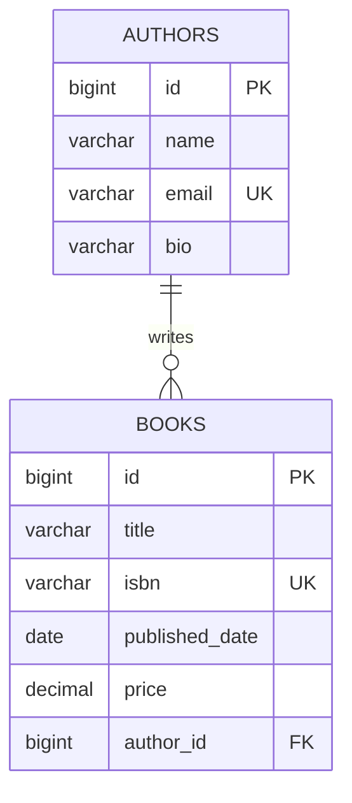

<h1 align="center">📚 Library Management System</h1>

<p align="center">
  A production-style RESTful API for managing books and authors, built with <b>Spring Boot</b>, <b>Spring Data JPA</b> and <b>MySQL</b>.
</p>

<p align="center">
  
  
  
  
  
</p>

---

## 📖 Overview

This project is a backend REST API that handles the core of a library catalogue: creating, reading, updating and deleting **books** and **authors**, linking books to authors, and searching the catalogue.

It follows a clean **layered architecture** (Controller → Service → Repository), uses **DTOs** to keep the API contract separate from the database model, validates every incoming request, and returns a **consistent response envelope** for both success and error cases.

## ✨ Features

- Full **CRUD** for Books and Authors
- **One-to-many** relationship: one author, many books
- Assign or re-assign an author to a book
- **Search** books by title and authors by name (case-insensitive, partial match)
- Filter books **published after** a given date
- List all books written by a specific author
- **Request validation** with clear, field-level error messages
- **Global exception handling** with proper HTTP status codes (`400`, `404`, `409`, `500`)
- **Uniform response format** (`data`, `apiError`, `timestamp`) via a global response wrapper
- **Business rules** enforced: unique ISBN, unique author email, an author with books cannot be deleted

## 🛠️ Tech Stack

| Layer | Technology |
|---|---|
| Language | Java 21 |
| Framework | Spring Boot 4.1 (Spring Web MVC) |
| Persistence | Spring Data JPA, Hibernate |
| Database | MySQL |
| Validation | Jakarta Bean Validation |
| Mapping | ModelMapper |
| Boilerplate | Lombok |
| Build tool | Maven |
| API testing | Postman |

## 🏗️ Architecture

```
Client (Postman / Frontend)
        │
        ▼
┌────────────────┐   validates input, returns ResponseEntity
│   Controller   │
└────────────────┘
        │  DTO
        ▼
┌────────────────┐   business rules, DTO ⇄ Entity mapping
│    Service     │
└────────────────┘
        │  Entity
        ▼
┌────────────────┐   Spring Data JPA
│   Repository   │
└────────────────┘
        │
        ▼
      MySQL
```

Cross-cutting: `GlobalExceptionHandler` converts exceptions into structured error responses, and `GlobalResponseHandler` wraps every successful response in a common envelope.

### Project Structure

```
src/main/java/com/example/library
├── advices        # Global exception handler, response wrapper, ApiResponse / ApiError
├── Config         # ModelMapper bean
├── Controller     # REST controllers (AuthorController, BookController)
├── dto            # Request/response DTOs with validation rules
├── entity         # JPA entities (AuthorEntity, BookEntity)
├── repository     # Spring Data JPA repositories
├── Service        # Business logic
└── LibraryManagementApplication.java
```

## 🗄️ Database Design



Tables are created automatically by Hibernate (`spring.jpa.hibernate.ddl-auto=update`).

## 🚀 Getting Started

### Prerequisites

- JDK 21+
- Maven 3.9+ (or use the included `mvnw`)
- MySQL 8+

### 1. Clone the repository

```bash
git clone https://github.com/<your-username>/library-management-system.git
cd library-management-system
```

### 2. Create the database

```sql
CREATE DATABASE library;
```

### 3. Configure environment variables

Database credentials are read from environment variables so no secrets live in the repository.

| Variable | Description | Default |
|---|---|---|
| `DB_USERNAME` | MySQL username | `root` |
| `DB_PASSWORD` | MySQL password | _(none, required)_ |

`src/main/resources/application.properties`:

```properties
spring.application.name=library-management

spring.datasource.url=jdbc:mysql://localhost:3306/library
spring.datasource.username=${DB_USERNAME:root}
spring.datasource.password=${DB_PASSWORD}

spring.jpa.hibernate.ddl-auto=update
spring.jpa.show-sql=true
spring.jpa.open-in-view=false
```

### 4. Run the application

```bash
# Windows
set DB_PASSWORD=your_password
mvnw.cmd spring-boot:run

# macOS / Linux
export DB_PASSWORD=your_password
./mvnw spring-boot:run
```

The API is now available at **`http://localhost:8080`**.

## 📡 API Reference

### Books &nbsp;`/book`

| Method | Endpoint | Description | Success |
|---|---|---|---|
| `POST` | `/book` | Create a book | `201 Created` |
| `GET` | `/book` | Get all books | `200 OK` |
| `GET` | `/book/{id}` | Get a book by id | `200 OK` |
| `PUT` | `/book/{id}` | Update a book | `200 OK` |
| `DELETE` | `/book/{id}` | Delete a book | `204 No Content` |
| `PATCH` | `/book/{bookId}/author/{authorId}` | Assign an author to a book | `200 OK` |
| `GET` | `/book/search?title={text}` | Search books by title | `200 OK` |
| `GET` | `/book/published-after?date=yyyy-MM-dd` | Books published after a date | `200 OK` |
| `GET` | `/book/author/{authorId}` | All books by an author | `200 OK` |

### Authors &nbsp;`/author`

| Method | Endpoint | Description | Success |
|---|---|---|---|
| `POST` | `/author` | Create an author | `201 Created` |
| `GET` | `/author` | Get all authors | `200 OK` |
| `GET` | `/author/{id}` | Get an author by id | `200 OK` |
| `PUT` | `/author/{id}` | Update an author | `200 OK` |
| `DELETE` | `/author/{id}` | Delete an author (only if they have no books) | `204 No Content` |
| `GET` | `/author/search?name={text}` | Search authors by name | `200 OK` |

### Example: create a book

**Request** &nbsp;`POST /book`

```json
{
  "title": "The Hobbit",
  "isbn": "9780547928227",
  "publishedDate": "1937-09-21",
  "price": 450.00,
  "authorId": 1
}
```

**Response** &nbsp;`201 Created`

```json
{
  "timestamp": "2026-10-06T19:34:34.6484542",
  "data": {
    "id": 7,
    "title": "The Hobbit",
    "isbn": "9780547928227",
    "publishedDate": "1937-09-21",
    "price": 450.00,
    "authorId": 1
  },
  "apiError": null
}
```

### Example: create an author

```json
{
  "name": "J.R.R. Tolkien",
  "email": "tolkien@example.com",
  "bio": "English writer and philologist."
}
```

### Validation rules

| Field | Rule |
|---|---|
| `title` | required, 2 to 200 characters |
| `isbn` | required, unique |
| `publishedDate` | required, format `yyyy-MM-dd` |
| `price` | required, greater than 0 |
| `authorId` | required, must reference an existing author |
| `author.name` | required, 3 to 100 characters |
| `author.email` | required, valid email, unique |
| `author.bio` | optional, max 500 characters |

### Error handling

Every error follows the same structure:

```json
{
  "timestamp": "2026-10-06T19:34:34.6484542",
  "data": null,
  "apiError": {
    "status": "BAD_REQUEST",
    "message": "Failed To Validate",
    "suberrors": [
      "Book title is required",
      "Price must be greater than zero"
    ]
  }
}
```

| Status | When |
|---|---|
| `400 Bad Request` | Request body failed validation |
| `404 Not Found` | Book or author does not exist |
| `409 Conflict` | Duplicate ISBN / email, or deleting an author who still has books |
| `500 Internal Server Error` | Unexpected server error |

## 📸 Screenshots

### Get all books


### Create a book


### Validation error


### Search books by title


### Delete a book (`204 No Content`)


## 🗺️ Roadmap

- [ ] Pagination and sorting on list endpoints
- [ ] Unit and integration tests (JUnit 5, Mockito, Testcontainers)
- [ ] API documentation with Swagger / OpenAPI
- [ ] Authentication and authorization (Spring Security + JWT)
- [ ] Members and a borrow / return workflow
- [ ] Database migrations with Flyway
- [ ] Docker and Docker Compose setup

## 🤝 Contributing

Contributions, issues and feature requests are welcome. Fork the repo, create a feature branch, and open a pull request.

## 👤 Author

**Your Name**

- GitHub: [@your-username](https://github.com/your-username)
- LinkedIn: [your-profile](https://www.linkedin.com/in/your-profile)

---

<p align="center">If you found this project useful, consider giving it a ⭐</p>
